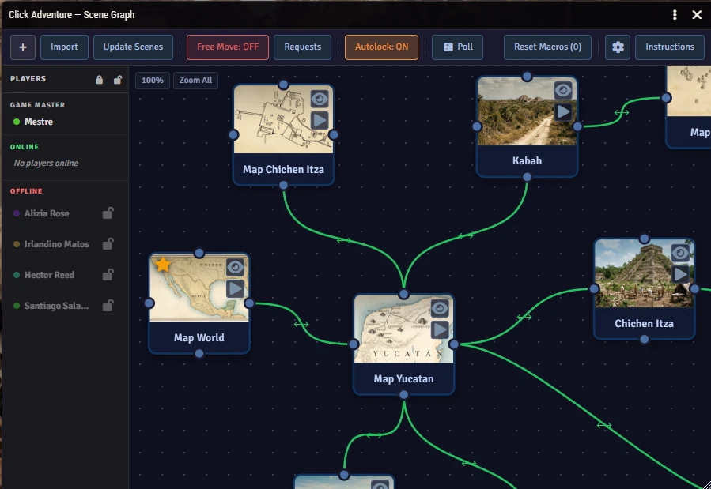
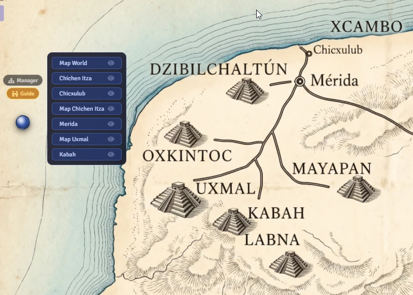
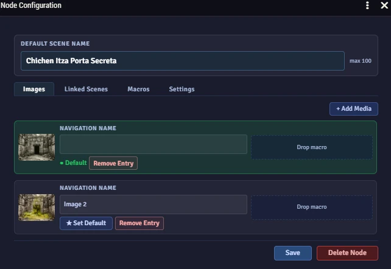
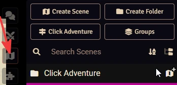

# 🗺️ Click Adventure

Moving players between scenes usually means the GM opening the Scenes tab, finding the next map and pulling everyone there by hand. Click Adventure lets the players do the walking.

You connect your scenes as nodes on a map, and players get a floating button that shows arrows to the places they can reach from where they are. They click a direction and arrive at the next scene, with a transition effect. You decide which passages are open, which are blocked or secret, and whether each move needs your approval. It works well for narrative sessions where the journey between places is part of the story.

[](https://buymeacoffee.com/mestredigital) [](https://mestredigital.online/pages/projetos-en)

## See it in action

[](https://youtu.be/Fbc-q51kSKc)

The video is in Brazilian Portuguese, but the interface is visual and easy to follow without the audio.

## What it looks like

### The scene manager

You build the adventure by placing scenes as nodes on a canvas, dragging them around and drawing links between them. The links define where players can go.



### The navigation HUD

During play, a floating button sits on screen. Players click it to see arrows pointing to the nearby locations, then pick one.



### Node configuration

Each location has one panel for its images, linked scenes, macros, journal page, background music, autolock rule and camera room settings.



## What it does

### Navigation and the graph

- Scenes are nodes on an infinite canvas, and the links you draw between them are every path through the adventure. Shift+click selects several nodes so you can drag them as a group, and Ctrl+A selects all of them.
- The navigation HUD is a floating button that players can customize. Clicking it fans out arrows to every destination they can reach.
- In **Open** mode, players move freely. In **Gated** mode, each travel request goes to the GM, who approves or rejects it. **Approve All** handles several requests at once.
- Each player has their own position in the graph, and the Manager shows where everyone is in real time.
- If your scenes are already organized in Foundry folders, you can import a whole folder into the graph in one click.

### Links

- Every passage has a direction and a state, set independently. The direction is Bidirectional, Forward only or Backward only. The state is **Open**, **Blocked** (visible but impassable), **Secret** (hidden from players, seen only by the GM) or **Custom** (crossable only once its key conditions are met). A plain click cycles the direction, and Ctrl/Cmd+click cycles the state. A one-way passage does not exist on its other side. To give the two ends different states, put two passages on the same link.
- A Custom passage is gated by keys. Drag an **Item** (the character must own it), an **Actor** (the character must be it), a **Macro** (it must run and `return true`) or a **Scene** (it must have been visited) onto the passage, and require all of them (**AND**) or just one (**OR**). Each player is checked against their own assigned character, and only when they actually try to cross, so a key macro's side effects never fire just because the HUD is open. The GM always bypasses the check. A Custom passage can also stay hidden until it unlocks.
- One connection between two nodes can hold several named passages, each with its own direction, state and display. A simple link cycles on click. A link with several passages opens its own editor and is drawn as a stack of thin dotted lines, one per passage, each coloured by its own state.
- Peek links are drawn corner to corner and show as a teal dashed line. The Camera Room feature uses them to let players watch other rooms without changing scenes.

### Nodes

- A location can have several background images. The GM switches between them live from the HUD, and the change reaches all players through a managed tile in the scene.
- A node can be linked to more than one Foundry scene, and you swap between them during play. This suits a place that looks different at different times.
- Macros attached to a node have a trigger (GM View, GM Activate, Player View, or GM View/Activate) and an execution mode (Always or Once). The same triggers are available on macros attached to a single image or linked scene. Macros fire on arrival however the player got there: HUD navigation, a GM teleport, or an approved request in Gated mode. Compendium macros are imported automatically. **Reset Macros** re-enables macros that already fired once.

  A macro set to *Player View* runs on the player's own client, so Foundry's permissions apply: the player must own the macro, and their role must be allowed to use script macros in **Configure Permissions**.
- Drag a journal page onto a node and it opens when players arrive, on scene view, on scene activate, or both. It is written to the Scene's own journal field, so it also shows in Foundry's scene configuration. Foundry permissions decide who sees it: a player with access to the page gets it on arrival, and a player without access gets nothing.
- Drag a playlist track, or a whole playlist, onto a node to set the Scene's playlist. Foundry starts it when the scene is **activated**, as it normally does. Both the music and the journal page accept compendium documents and import them into the world automatically.
- Each node can override the global autolock setting: **Inherit**, **Open** (always unlock on arrival) or **Locked** (always lock on arrival).
- Any node can be marked as a Camera Room. Teal corner anchors then appear on all nodes, and dragging from corner to corner creates a peek link. Players inside a camera room get a **Cameras** button in their HUD. Clicking a room swaps their background tile locally to show that room's image, with no scene change and nothing sent to other players. It resets when they move.
- Right-click a node to set it as the active location, lock or unlock all players there, or delete it.
- Nodes show colored badges for the players standing on them, so you can see who is where.
- If every passage out of a node is Blocked or Secret, its card gets a red outline and a tooltip saying so. This is only a hint for the GM. Nothing is blocked or fixed automatically.

### Adventure groups

- A campaign can be split into named **Groups**, each with its own scene graph. You can switch between them at any time, and activating a group moves all players to that group's starting node.
- Each group keeps its Foundry scenes in its own folder, so building or updating one adventure never touches another's scenes, along with any tiles, tokens, lighting or edits you made there. Deleting a group removes its folder and scenes, and **Reset Group** only affects the group you are working in.
- Selected groups can be exported to a JSON file and imported into any world. The import creates the scenes and finds the referenced documents by name: macros, linked scenes, journal pages and playlist tracks reconnect to the matching documents in the destination world. Anything that cannot be found is reported as a warning, and the import still finishes. Use it to share a finished adventure or to back up your work. An import file can also be written by hand or by a script: only the group's name and each node's label are required, and links can name their nodes by label. The format is in [docs/API.md](docs/API.md#export-files).
- An adventure module can declare its adventures in its own `module.json`. While that module is active, **Export / Import** lists them with an **Import** button. Once one is in the world, its row shows the version you have and whether the module has a newer one. **Update** shows what will change and then applies the module's new content, keeping the scenes, Manager positions, opened doors, fired macros and nodes you added. **Replace** asks for confirmation and then starts the group over. Nothing is imported automatically.

### Flight over the map

- A group can have an overview map: one image of the whole place, turned into a scene where each room is a GM-only Region linked to its node.
- In Guide mode, the GM double-clicks a room on the overview and the party flies over the map to it. **Map** in the HUD brings everyone back out to the overview, and Guide moves between rooms with Regions also fly. Moves without a Region, and moves players make on their own, use the normal transition.
- The flight takes longer the farther it goes, from about 1.5 seconds between neighbouring rooms to about 3 seconds across the map.
- The **Flight over Map** card, in the **Scenes** tab of the settings, turns flight on for the current group, picks the overview map, links rooms to nodes, previews them and imports room data from a JSON file. It also sets the group's pace (**Slow**, **Normal** or **Fast**) and an optional travel sound with its volume. The sound plays on each player's Interface volume.
- The overview map, its rooms, the pace and the sound are kept when the group is exported.

### GM tools

- In Guide Mode, the GM either navigates **Solo** (only their own view moves) or acts as a **Guide**, pushing scene views to individual players or activating scenes for everyone. The HUD switches between the two.
- The player panel in the Manager lists every user (GM, online and offline players) with their current node, lock state and user color.
- The Manager can create Foundry scenes for all nodes at once, or update existing scenes so their name, transition settings and background tile match the graph.
- The module creates and maintains a locked background tile in each scene that shows the node's active image. Tiles you placed yourself are left alone.
- Lock all players at once from the toolbar, or lock and unlock them one by one in the player panel. The lock state is saved when the game is paused and restored when it resumes.
- When the [Visual Polls](https://github.com/brunocalado/visual-polls) module is active, a **Poll** button appears in the Manager toolbar. It opens a vote on where to go for all online players, with the destination images as thumbnails. Blocked and locked links are left out of the vote.

### Player experience

- Players see an animated transition when they move: Fade, Swirl, Water Drop, Morph, Crosshatch, Wind, Waves, White Noise, Hologram, Hole, Hole Swirl, Glitch, Dots, or None.
- Autolock keeps players from moving until the GM unlocks them. The lock survives pausing and resuming the game.
- You can capture a token position for each player, so characters arrive exactly where you want in each new scene.
- **Load Player Tokens**, in the Tokens tab, decides per group whether each player's linked-actor token is created and moved into a node's scene as they navigate. When it is off, navigation only changes the view, and tokens already placed are left where they are. It is on by default. Turning on **Saved Positions** or capturing positions switches it on, because both need loaded tokens.
- Players can hover the eye icon on a destination arrow to see that room's image before going there. The GM turns this on in the HUD tab. It is off for players by default, and the GM always sees the previews.
- The HUD lists the other connected players. Hovering the eye icon next to one shows the image of the node that player is on, even in a different scene. This can be turned off in the settings.

### Customization

- Every window in the module uses the same dark look: dark surfaces, amber for confirming actions, blue for adding things, and green for on or default states. It stays dark whatever Foundry theme you use.
- The HUD button can be an orb or a square, with your own color, an optional custom image, and a size of your choice. The settings panel shows a live preview.
- The HUD can be shown to all players or to the GM only.
- The settings panel covers the transition type, HUD visibility, token behavior, Guide Mode and more. It is split into **Scenes**, **HUD**, **Tokens** and **Danger** tabs, with toggle switches for on/off options.
- A help reference opens from the Manager toolbar.

## Opening the Manager

The Manager is where you build the scene graph. Only the GM can open it.

### From the Scenes tab

Open the **Scenes** tab in the sidebar. The directory header has a **Click Adventure** button and a **Groups** button. Click **Click Adventure** to open the Manager.



### From a macro

Create a script macro with this code:

```js
ClickAdventure.Manager();
```

To open the Groups manager:

```js
ClickAdventure.Groups();
```

To open the navigation HUD:

```js
ClickAdventure.HUD();
```

## For developers

Macro writers and module developers can find the full API, how Click Adventure runs your macros, the overview map's room format and where the module stores its data in [docs/API.md](docs/API.md).

## Building a distributable adventure module

To package your adventure for other people, follow the guide in the [Wiki](https://github.com/brunocalado/click-adventure/wiki/Building-a-Distributable-Adventure-Module-for-Click-Adventure). The flag that makes your module's adventures show up in **Export / Import** is described in [docs/API.md](docs/API.md#shipping-an-adventure-in-your-module).

## Installation

Click Adventure requires Foundry VTT v14.

1. Open Foundry VTT and go to **Add-on Modules**.
2. Click **Install Module**.
3. Paste this manifest URL in the **Manifest URL** field at the bottom:

```
https://github.com/brunocalado/click-adventure/releases/latest/download/module.json
```

4. Click **Install** and wait for it to finish.
5. Enable the module in your world through **Manage Modules**.

## Recommended modules

- [Hide UI](https://github.com/brunocalado/hide-ui) hides Foundry's default interface so the scene takes the whole screen.
- [Visual Polls](https://github.com/brunocalado/visual-polls) adds the group vote on where to go to the Manager toolbar.

## Bug reports and feature requests

If you found a bug or have an idea, open an issue on GitHub: https://github.com/brunocalado/click-adventure/issues

## Contributors

Thanks to everyone who has taken the time to improve Click Adventure.

- [@mordachai](https://github.com/mordachai): [#14](https://github.com/brunocalado/click-adventure/pull/14)

## 📄 License

This module is released under the [LICENSE](LICENSE) included in this repository.
